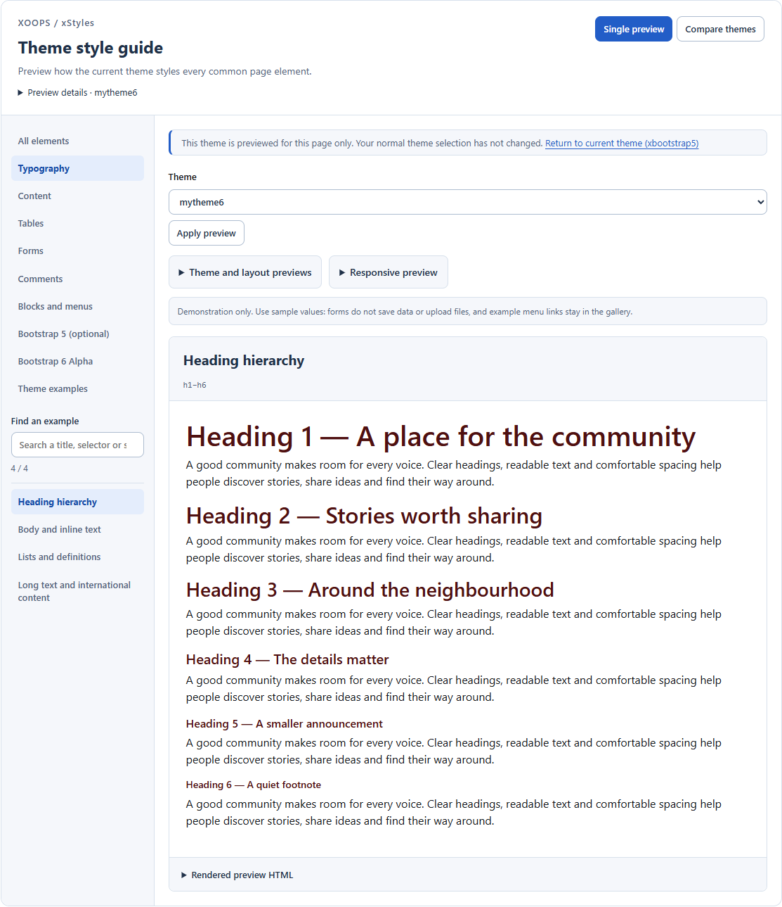
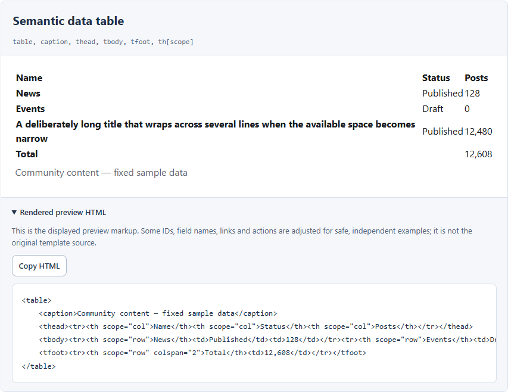
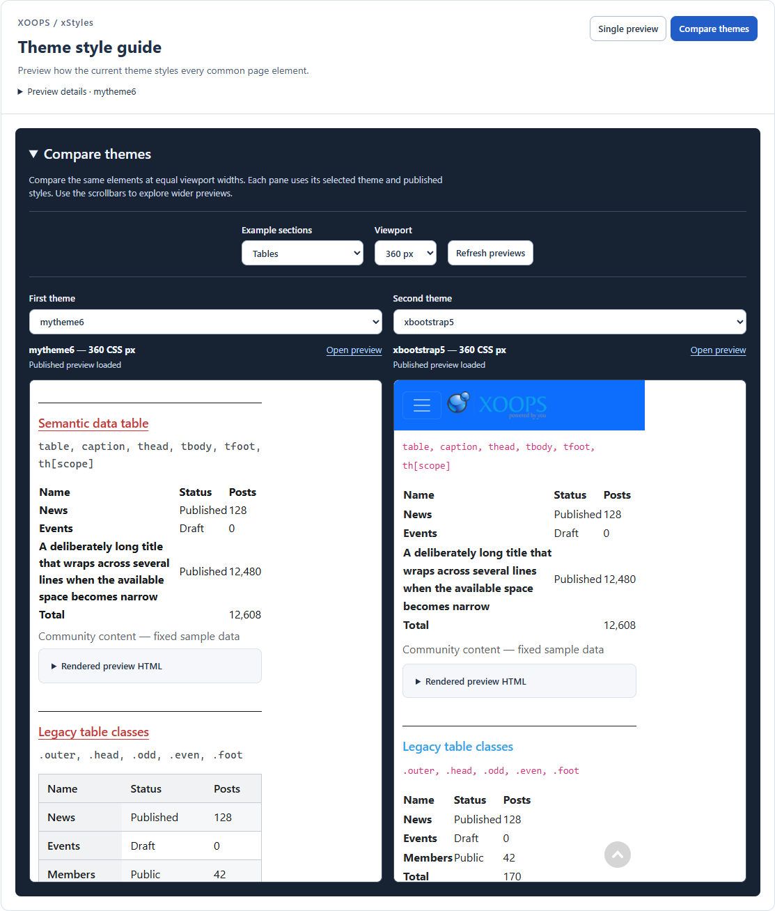
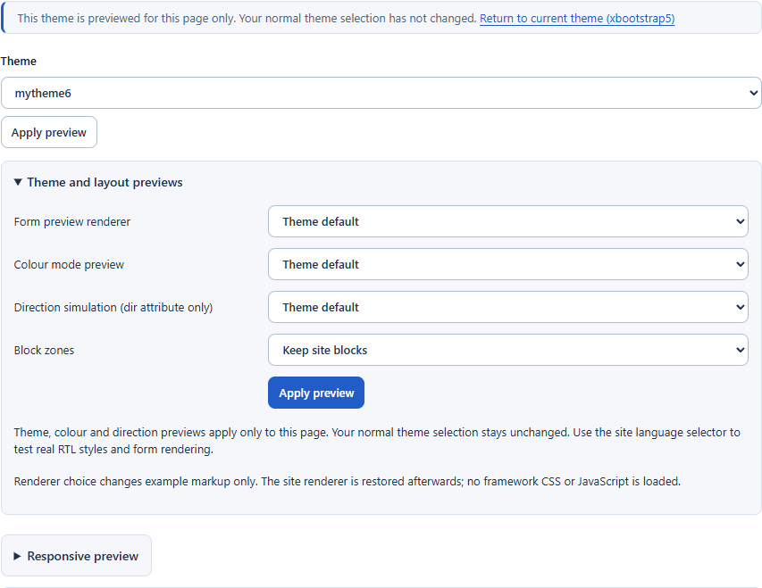

# xStyles Tutorial

**Preview how the current theme styles every common page element.**

xStyles is a living style guide for XOOPS themes. It puts headings, text, tables,
forms, comments and menus in one place, using the selected theme's actual styles.
The sample content stays the same, making differences easier to spot.

Use it to:

- Check whether a theme looks consistent before using it on your site.
- Compare two themes without activating a different site or administration theme.
- Find problems with long text, narrow screens, form controls and block layouts.
- Review a design change against repeatable examples instead of searching through
  several modules for suitable content.

xStyles does not create sample articles or database tables, save form submissions,
or require upload folders. Its preview controls do not publish design changes.
Editing and publishing styles, when available, belong to the separate **cssHolmes** module.

## Choose your path

1. [Beginner: explore your theme](#1-beginner-explore-your-theme)
2. [Advanced: test and compare themes](#2-advanced-test-and-compare-themes)
3. [Theme designer: inspect and improve a design](#3-theme-designer-inspect-and-improve-a-design)

There is also a [troubleshooting reference](#troubleshooting) at the end.
Screenshots show xStyles 1.5 with example installed themes. Your theme names,
available controls and sample styling may differ.

## 1. Beginner: explore your theme

### Open the gallery

1. Install xStyles through **System → Modules**, or update the module after
   replacing an older installation.
2. Open `/modules/xstyles/` on your site. From module administration, use the
   standard **Go to module** link.
3. Start in **Single preview**. Open **Preview details** to see the theme,
   language/direction and form renderer used by the page.



*The surrounding workspace stays consistent; the examples show the selected theme's styling.*

### Find an element and inspect it

1. Choose a category in the navigator, such as **Typography**, **Tables** or **Forms**.
2. Choose an individual element below the search box. For example, open
   **Typography → Heading hierarchy** to compare the sizes and spacing of headings.
3. Read the preview, then try another element. In **Tables**, look at long titles
   and alternating rows. In **Forms**, inspect required fields, disabled controls
   and the spacing between labels and inputs.
4. Use **Find an example** to search the current category. Press **Escape** to clear
   the search. Choose **All elements** first if you want to search the whole catalog.

The two numbers below the search box show matching examples and the category's
total. A normal JavaScript-enabled workspace shows one selected example at a time.
On a narrow screen, the navigator moves above the preview.

**Forms are demonstrations.** Use sample values only. Preview buttons do not save
records, and file controls do not upload files. Example navigation links stay in
the gallery.

### See how an element is built

1. Expand **Rendered preview HTML** beneath an example.
2. Read its markup, or choose **Copy HTML**.
3. If clipboard access is unavailable, the code is selected for you. Press
   **Ctrl+C** on Windows/Linux or **Command+C** on macOS to copy it manually.



This is the HTML rendered for the preview, not the original Smarty template.
Some IDs, links and form actions are adjusted for the gallery. Treat copied HTML
as a reference when building a real page, not as a ready-to-save application form.

### Check the administration theme

1. Open xStyles in XOOPS administration.
2. Use **Home** for the module shortcuts, configuration checks and server status.
3. Open **Admin styles** to inspect the administration theme's examples.
4. Choose an admin-theme link above the examples to preview another installed
   admin theme. Use **Return to current theme** to leave the temporary preview.

The admin gallery contains the relevant core element categories. It also supports
**Compare themes**, described below. These previews do not activate a different
admin theme for the site. The tabs remain **Home → Admin styles → About → Help**.

## 2. Advanced: test and compare themes

### Preview another frontend theme

1. In **Single preview**, choose a theme from the **Theme** list.
2. Click **Apply preview**.
3. Browse categories as usual. The notice above the controls identifies the
   temporary preview and provides **Return to current theme**.

The list contains installed themes allowed for visitors by your site. Selection
applies to the preview request; it does not activate a site-wide theme. Theme
switching requires a XOOPS core with the request-only module-theme override;
XOOPS 2.7.4 omits frontend theme selection and side-by-side theme comparison.
You can still inspect the current frontend theme and use layout, renderer and
responsive previews. **Admin styles** supports theme selection and comparison
on both tested cores, XOOPS 2.7.4 and 2.8.

### Compare two themes side by side

1. Click **Compare themes** at the top of either gallery.
2. Choose **First theme** above the left pane and **Second theme** above the right.
3. Choose a category under **Example sections**. Try **Tables** or **Forms** first.
4. Choose a shared **Viewport**: **360 px**, **768 px** or **1280 px**. Changes to
   these selections reload the previews automatically.
5. Scroll within each pane to inspect the same examples. Use **Refresh previews**
   after changing published styles, or **Open preview** to inspect a pane in its own tab.
6. Click **Single preview** to return to your selected example.



Both documents use the selected viewport width, even when the available pane is
narrower. Horizontal scrolling is intentional: it preserves the actual layout at
that width. Each preview retains its theme's page layout, including headers and
blocks. On narrow screens, the panes stack vertically.

**Open preview** opens a full gallery with its controls available. Its
**Return to current theme** link also returns to the full gallery.

### Test responsive layouts

1. In the public gallery's **Single preview**, select the category you want to test.
2. Expand **Responsive preview**.
3. Select **360 px**, **768 px**, **1280 px**, or **Compare all widths**.
4. Check wrapping, overflow and controls at each width. Close the disclosure when
   finished to unload its frames.

These are real browser viewport widths for the embedded pages, rather than scaled
screenshots. Responsive and comparison frames show **published styles**. Unsaved
cssHolmes changes in the parent page are not transferred into them.

### Check forms, colour modes, direction and blocks

Expand **Theme and layout previews**, choose your options, and click **Apply preview**.



| Control | What to try | What it changes |
| --- | --- | --- |
| **Form preview renderer** | Start with **Theme default**, then compare **Legacy** and **Bootstrap 5**. | The example form markup. It does not install Bootstrap or change the site's normal renderer. |
| **Colour mode preview** | Compare **Light**, **Dark** and **System preference**. | The page's mode attributes. The theme must supply styles for those modes. |
| **Direction simulation (dir attribute only)** | Try **RTL**, then return to **Theme default**. | Text direction only. Use the site's language selector to test an actual RTL locale and its stylesheets. |
| **Block zones** | Try **Populate all 12 zones**, **Populate without titles**, and **Empty all zones**. | Temporary example blocks in zones supported by the theme. Choose **Keep site blocks** to restore ordinary rendering. |

The **Bootstrap 5 (optional)** and **Bootstrap 6 Alpha** categories require the
selected theme's corresponding CSS and JavaScript. xStyles does not load either
framework for you. An unavailable interactive preview usually means the required
component is missing or incompatible. The Bootstrap 6 examples target
`6.0.0-alpha.1` and are experimental.

## 3. Theme designer: inspect and improve a design

### Use a repeatable review cycle

1. Pick a representative example and note the theme, category, mode and viewport.
2. Inspect its **Rendered preview HTML** and the selectors beneath its heading.
   Use browser developer tools to identify which theme rule supplies a style.
3. Change your theme stylesheet or use the optional cssHolmes designer.
4. Reload the same example and repeat the same preview settings.
5. Check neighbouring categories and a real module page before publishing or
   distributing your theme. A heading change can also affect forms or comments.

For a final pass, check long text, disabled and focused controls, table overflow,
empty block zones, supported colour modes, and keyboard navigation. The gallery
helps expose problems; it is not an automatic accessibility certification.

### Work with cssHolmes

This is optional. xStyles provides the examples; cssHolmes provides the editing
tools and stores published design overrides.

1. Log in with cssHolmes access. Its administrators have access; other groups
   need **Overlay** and **Edit** permissions to preview changes, plus **Workbench**
   permission to save them.
2. Open the frontend gallery and choose **Open theme designer**, when available.
3. Choose **Pick element**, then select an element inside the example. Check the
   displayed selector and matching-element count before editing.
4. Adjust a property, such as text colour or spacing. Prefer a reusable selector
   that also matches real pages, rather than a gallery-only `xs-…` ID.
5. Inspect the result. **Discard draft** returns to the last saved state.
   **Save to theme** publishes the draft for that theme and can affect visitors.
6. After publishing, use **Refresh previews** in xStyles to check the result at
   other widths and in comparisons. The designer stays outside embedded previews.

Saving a named set to the cssHolmes library is separate from publishing it to a
theme. See the cssHolmes module documentation for configuration sets, exports,
restoring previous saves and resetting published overrides.

### Add your own theme examples

Use **Theme examples** for components specific to your theme, such as a feature
card or custom navigation. This also makes them available in responsive previews
and theme comparisons.

1. Inside your theme, create `modules/xstyles/specimens.json`:

   ```json
   {
     "version": 1,
     "specimens": [
       {
         "id": "feature-card",
         "title": "Feature card",
         "selector": ".feature-card",
         "template": "specimens/feature-card.tpl"
       }
     ]
   }
   ```

2. Create `modules/xstyles/specimens/feature-card.tpl` in the same theme:

   ```html
   <article class="feature-card">
       <h3>News from the community</h3>
       <p>A short example for checking the theme's card styles.</p>
   </article>
   ```

3. Use your theme's existing component markup and classes, or add the component's
   styles to your theme stylesheet. xStyles does not generate component CSS.
4. Preview that theme in xStyles and open **Theme examples**. Reload after editing
   the template or descriptor. No module template registration is required.

The complete paths begin with `themes/<your-theme>/`. These are trusted installed
theme files: use fixed example content, and avoid database queries, uploads or
save actions. For dynamic Smarty values, use XOOPS delimiters and escape output,
for example `<{$xs_theme_url|escape}>`. Templates also receive `xs_module_url` and
`xs_specimen_id`. Gallery IDs and supported references are prefixed automatically;
CSS classes remain unchanged.

The word **specimens** in these filenames is the technical name for the examples
collection. Users see the simpler label **Theme examples** in the gallery.

## Troubleshooting

| What you see | What to check |
| --- | --- |
| A theme is missing from the frontend list. | Confirm it is installed and allowed for visitors. Admin-theme choices come from the installed admin-theme catalog instead. |
| Frontend theme selection or comparison is unavailable. | Check that the XOOPS core supports request-only module-theme previews and that selectable themes are available. |
| No matching examples. | Clear the search with **Escape**, or switch to **All elements** before searching again. |
| Copy HTML does not copy automatically. | Use the selected source text and your keyboard's copy shortcut. Clipboard access can be restricted on HTTP sites. |
| An embedded preview is unavailable. | Use **Open preview**. Site framing restrictions may prevent embedding. |
| A published change is missing in a pane. | Click **Refresh previews**. Unsaved designer drafts are visible only in their original editing page. |
| RTL or dark mode looks unchanged. | The theme needs compatible styles. Direction simulation alone does not load a real RTL language. |
| A notice lists form labels without matching controls. | It reports a problem in the active core form renderer's output; xStyles deliberately leaves the output visible for inspection. |
| Theme examples is empty. | Add a valid `modules/xstyles/specimens.json` and its templates to the theme being previewed. |

For installation requirements and technical verification commands, see the
[module README](../README.md).
